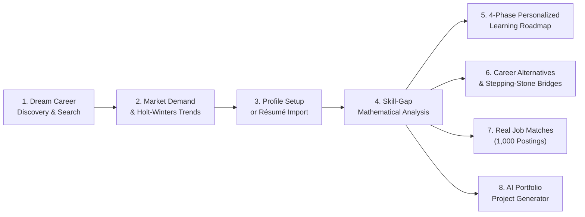

# SkillGraph AI — Student Career Intelligence & Skill-Gap Platform

[](https://fastapi.tiangolo.com/)
[](https://react.dev/)
[](https://www.typescriptlang.org/)
[](https://www.python.org/)
[](#automated-testing)
[](https://opensource.org/licenses/MIT)

> **"Discover your dream career, understand its market demand, identify your skill gaps, and explore the career opportunities your skills can unlock."**

SkillGraph AI is an AI-powered, student-centered career skill intelligence and roadmap platform built upon real labor-market data from **O\*NET 31.0**, **ESCO v1.1.1**, and empirical **LinkedIn job postings**. It translates raw job-market data into personalized, evidence-backed career guidance without requiring students to decipher complex statistics or labor-market jargon.

---

## 🚀 Key Innovation Highlights (Production-Grade Features)

SkillGraph AI delivers a complete, full-stack, data-driven experience designed to major college project & production standards:

1. **Instant Opportunity Matcher (`/opportunities`)**:
   - Matches candidate skill profiles against **1,000 real job postings** in real-time.
   - Computes exact match percentages, matched skills, missing skills, salary ranges, and direct application links with location and role filters.
2. **Future Skill Radar & Early-Warning System (`/future-radar`)**:
   - Computes demand velocity ($\Delta \text{share}/\Delta t$) and detects *Surging* vs. *Decaying* competencies.
   - Half-Life Decay calculator warns students against over-investing in declining tooling.
3. **Career What-If Simulator & Stepping-Stone Bridges (`/simulator`)**:
   - Real-time what-if scenario testing: "What happens to my job readiness if I learn Docker & AWS?"
   - Discovers stepping-stone intermediate roles that require $\le 2$ new skills to reach.
4. **Hidden & Transferable Skill Detection + Evidence Verification (`/transferable`)**:
   - Identifies latent, adjacent skills derived from existing proficiencies with statistical confidence scores.
   - Evidence-based verification system allowing students to corroborate claimed skills with GitHub repos, portfolio links, or project code.
5. **AI Portfolio Project Generator & Learning ROI Optimizer (`/projects`)**:
   - Generates tailored, production-ready portfolio project briefs that target multiple missing skills simultaneously.
   - Prioritizes learning paths using a composite ROI model (Market Demand $\times$ Cross-Role Versatility $\div$ Time-to-Learn).
6. **Instant Résumé Skill Extraction Modal (`/gap-analysis`)**:
   - Zero-retention inverted-index regex parser that extracts standardized skills from raw résumé text in under 10ms with zero PII persistence.
7. **Labor Market Intelligence & Confidence Monitor (`/system/admin`)**:
   - Live audit telemetry tracking Market Confidence Scores (0-100), duplicate rates, extraction coverage, and modular data provider statuses (ESCO, Adzuna, O*NET, JSearch).

---

## 🎯 6 Core Student Questions Answered

1. **Is my dream job currently in demand?**
   - Live demand status badges (*High Observed Demand*, *Moderate Observed Demand*, *Emerging Pathway*, *Limited Observed Demand*) based on empirical posting volumes and verified employer counts.
2. **How is demand changing, and what might happen in the future?**
   - Monthly historical posting trajectories and statistical Holt-Winters exponential smoothing forecasts with 95% confidence intervals (with strict data sufficiency validation).
3. **Which skills do employers require for this job?**
   - Blended competency requirements combining official O\*NET importance scores ($w_s \in [0.2, 1.0]$) and real posting demand frequency percentages.
4. **Which required skills do I already possess, and which do I need to learn?**
   - Dynamic profile evaluation matching student skills across Beginner, Intermediate, and Advanced proficiencies.
5. **What should I learn first to become better prepared?**
   - Mathematically weighted skill coverage calculation and composite priority ranking prioritizing high-leverage skills, paired with a 4-phase structured learning roadmap and practical GitHub portfolio project ideas.
6. **What other career opportunities can I pursue with my skills?**
   - Career mobility matching across 1,016 occupations discovering Strong, Moderate, and Emerging transitions with shared competencies and gap breakdowns.

---

## 🧭 The End-to-End Student Journey



---

## 🖥️ Platform Pages & Navigation

### Student Career Experience
- **Home (`/`):** Hero search with live autocomplete across 1,016 occupations and 8,000+ title aliases, quick role chips, 6 question cards, and dataset transparency notice.
- **Dream Career Intelligence (`/careers/:careerId`):** Role demand status, verified employers, Holt-Winters trend/forecast chart, skill requirements bar chart, and comparison drawer.
- **My Skills Profile (`/profile`):** Interactive skill builder from 8,800+ canonical competencies or custom entries with Beginner / Intermediate / Advanced toggles.
- **Skill Gap Analyzer (`/gap-analysis`):** Visual coverage donut gauge, breakdown into Covered, Skills to Strengthen, and High-Priority Missing skills, plus instant Résumé Text Parsing modal.
- **Job Opportunity Matcher (`/opportunities`):** Live matching against 1,000 real job postings, with salary ranges, match percentages, and direct job links.
- **Future Skill Radar (`/future-radar`):** Early-warning system displaying demand velocity spikes, half-life trajectories, and fading vs. surging tools.
- **Career Simulator & Bridges (`/simulator`):** What-if skill simulator and stepping-stone career pathways requiring $\le 2$ incremental skills.
- **Transferable Skills & Evidence (`/transferable`):** Discovers unlisted adjacent capabilities and verifies claimed skills with GitHub repos or project descriptions.
- **Portfolio Project Generator (`/projects`):** Generates portfolio project ideas maximizing learning ROI and closing multiple skill gaps in one build.
- **Learning Roadmap (`/roadmap`):** 4 structured phases (*Foundations*, *Core Target Role*, *Advanced Tooling*, and *Applied Projects*) with interactive progress trackers.
- **Career Alternatives & Mobility (`/alternatives`):** Skill-based career matching across 1,016 roles categorized by Strong ($\ge 50\%$), Moderate ($\ge 30\%$), and Emerging pathways.
- **Interactive Career Graph (`/graph`):** React Flow radial network visualization highlighting target role, student-owned skills (green), and missing requirements (rose).

### Labor Market & Governance
- **Market Dashboard (`/dashboard`):** Macro-level labor market distributions, top in-demand competencies, surging skills, and co-occurrences.
- **Data Quality & Governance (`/system/admin`):** Market Confidence Score, data hygiene metrics, and status of external providers (ESCO, Adzuna, O*NET, JSearch).
- **System Provenance & Pipeline (`/system/data`, `/system/pipeline`, `/system/evaluation`):** Dataset SHA-256 checksums, pipeline stage telemetry, and model benchmarks.

---

## 🔬 Mathematical Formulas & Rigor

### 1. Weighted Skill Coverage Formula
$$\text{Skill Coverage (\%)} = 100 \times \frac{\sum_{s \in \text{Matched}} (\alpha_s \cdot w_s)}{\sum_{s \in \text{Target}} w_s}$$
- Intermediate and Advanced proficiencies receive full credit ($\alpha_s = 1.0$).
- Beginner proficiency receives partial credit ($\alpha_s = 0.6$) and is flagged for practical strengthening.

### 2. Composite Learning Priority Score
For missing competencies, learning priority is ranked using a composite multi-factor score:
$$\text{Priority Score} = 0.40 \times \text{Relevance} + 0.35 \times \text{Demand Share} + 0.25 \times \text{Category Weight}$$

### 3. Learning ROI Formula
$$\text{Learning ROI} = \frac{\text{Demand Score} \times \text{Versatility Score}}{\text{Estimated Learning Weeks}}$$

---

## 🛠️ Technology Stack

- **Frontend:** React 18, TypeScript, Vite, Tailwind CSS, Recharts, `@xyflow/react` (React Flow v12), Lucide React.
- **Backend:** Python 3.11+, FastAPI, Pydantic v2, SQLAlchemy, Uvicorn, SQLite (pre-populated with 1,016 occupations, 8,828 skills, 31,821 mappings, and 1,000 real job postings).
- **Data Science & ML:** pandas, NumPy, SciPy, scikit-learn, statsmodels, NetworkX, spaCy.
- **Testing:** pytest, FastAPI TestClient (**55 passed tests**).

---

## 💻 Quick Start Instructions (Local Setup)

### 1. Prerequisites
- **Python 3.11+**
- **Node.js 18+** & npm

### 2. Clone the Repository
```bash
git clone https://github.com/palakchandak261/SkillGraph-AI.git
cd SkillGraph-AI
```

### 3. Backend Setup
```bash
# Create and activate virtual environment (optional but recommended)
python -m venv venv
# Windows:
.\venv\Scripts\activate
# Linux/macOS:
source venv/bin/activate

# Install dependencies
pip install -r requirements.txt

# Run backend server
python -m uvicorn backend.app.main:app --host 127.0.0.1 --port 8000 --reload
```
Backend API will be available at: `http://127.0.0.1:8000` (Interactive docs at `http://127.0.0.1:8000/docs`).

### 4. Frontend Setup
```bash
# In a new terminal:
cd frontend
npm install
npm run dev
```
Frontend client will run at: `http://127.0.0.1:5173`.

---

## 🧪 Automated Testing

Run the complete test suite verifying all 55 integration, unit, ETL, and ML feature tests:

```bash
python -m pytest -v
```

```text
============================= test session starts =============================
backend/tests/test_api.py::test_api_health PASSED                        [  1%]
...
backend/tests/test_features.py::test_opportunity_matcher PASSED          [ 67%]
backend/tests/test_features.py::test_resume_parser PASSED                [ 69%]
backend/tests/test_features.py::test_market_dashboard PASSED             [ 70%]
backend/tests/test_features.py::test_data_quality_report PASSED          [ 72%]
...
============================= 55 passed in 16.01s =============================
```

---

## 📚 Technical Documentation

- **[System Architecture](docs/ARCHITECTURE.md)**: End-to-end architecture diagrams, algorithms, and database design.
- **[API & Provider Setup](docs/API_SETUP.md)**: Configuration guide for Adzuna, ESCO, JSearch, and O*NET providers.
- **[Model Evaluation](docs/MODEL_EVALUATION.md)**: Benchmark results for NLP extraction and time-series forecasting.
- **[Data Dictionary](docs/data_dictionary.md)**: Detailed schema specification and field definitions.
- **[Methodology Guide](docs/methodology.md)**: Mathematical formulations and data preprocessing rules.

---

## 📄 License

This project is licensed under the [MIT License](LICENSE).
Labor market taxonomy data courtesy of [O\*NET](https://www.onetcenter.org/) (U.S. Department of Labor) and [ESCO](https://esco.ec.europa.eu/) (European Commission).
