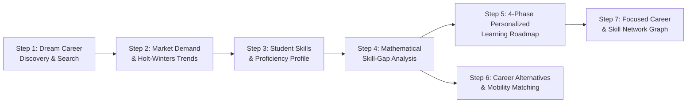

# SkillGraph AI — Student Career Intelligence & Skill-Gap Platform

[](https://fastapi.tiangolo.com/)
[](https://react.dev/)
[](https://www.typescriptlang.org/)
[](https://www.python.org/)
[](#automated-testing)
[](https://opensource.org/licenses/MIT)

> **"Discover your dream career, understand its market demand, identify your skill gaps, and explore the career opportunities your skills can unlock."**

SkillGraph AI is an AI-powered, student-centered career skill intelligence and roadmap platform built upon real labor-market data from **O\*NET 31.0**, **ESCO v1.1.1**, and empirical **LinkedIn job postings**. It translates raw job-market data into personalized, evidence-backed career guidance without requiring students to decipher complex statistics or labor-market jargon.

---

## 🎯 6 Core Student Questions Answered

1. **Is my dream job currently in demand?**
   - Live demand status badges (*High Observed Demand*, *Moderate Observed Demand*, *Emerging Pathway*, *Limited Observed Demand*) based on empirical posting volumes and verified employer counts.
2. **How is demand changing, and what might happen in the future?**
   - Monthly historical posting trajectories and statistical Holt-Winters exponential smoothing forecasts with 95% confidence intervals (with strict data sufficiency validation).
3. **Which skills do employers require for this job?**
   - Blended competency requirements combining official O\*NET importance scores ($w_s \in [0.2, 1.0]$) and real posting demand frequency percentages.
4. **Which required skills do I already possess, and which do I need to learn?**
   - Dynamic profile evaluation matching student skills across Beginner, Intermediate, and Advanced proficiencies.
5. **What should I learn first to become better prepared?**
   - Mathematically weighted skill coverage calculation and composite priority ranking prioritizing high-leverage skills, paired with a 4-phase structured learning roadmap and practical GitHub portfolio project ideas.
6. **What other career opportunities can I pursue with my skills?**
   - Career mobility matching across 1,016 occupations discovering Strong, Moderate, and Emerging transitions with shared competencies and gap breakdowns.

---

## 🧭 The 7-Step Student Career Journey



---

## 🖥️ Platform Pages & Navigation

### Student Career Journey
- **Home (`/`):** Hero search with live autocomplete across 1,016 occupations and 8,000+ title aliases, quick role chips, 6 questions cards, and dataset transparency notice.
- **Dream Career Intelligence (`/careers/:careerId`):** Role demand status, verified employers, Holt-Winters trend/forecast chart, skill requirements bar chart, and comparison drawer.
- **My Skills Profile (`/profile`):** Interactive skill builder from 8,800+ canonical competencies or custom entries with Beginner / Intermediate / Advanced toggles.
- **Skill Gap Analyzer (`/gap-analysis`):** Visual coverage donut gauge, breakdown into Covered, Skills to Strengthen, and High-Priority Missing skills, plus a high-leverage "Suggested Next Skill to Learn" recommendation.
- **Learning Roadmap (`/roadmap`):** 4 structured phases (*Foundations*, *Core Target Role*, *Advanced Tooling*, and *Applied Projects*) with interactive progress trackers and verifiable portfolio deliverables.
- **Career Alternatives & Mobility (`/alternatives`):** Skill-based career matching across 1,016 roles categorized by Strong ($\ge 50\%$), Moderate ($\ge 30\%$), and Emerging pathways.
- **Interactive Career Graph (`/graph`):** React Flow radial network visualization highlighting target role, student-owned skills (green), and missing requirements (rose).
- **Student Progress Tracker (`/progress`):** Real-time readiness score, phase completion meters, and unlocked career opportunities.

### System & Transparency (Secondary Section)
- **Market Overview (`/system/overview`):** High-level dataset statistics, date coverage spans, and data completeness metrics.
- **Data Provenance (`/system/data`):** Dataset source URLs, file sizes, row counts, and SHA-256 checksums.
- **Pipeline Telemetry (`/system/pipeline`):** Status and execution logs for ETL, NLP extraction, graph construction, and forecasting.
- **Model Benchmarks (`/system/evaluation`):** Statistical evaluation benchmarks (MAE, RMSE, MASE, Precision/Recall).

---

## 🔬 Mathematical Formulas & Rigor

### Weighted Skill Coverage Formula
$$\text{Skill Coverage (\%)} = 100 \times \frac{\sum_{s \in \text{Matched}} w_s}{\sum_{s \in \text{Target}} w_s}$$
- Intermediate and Advanced proficiencies receive $100\%$ weight ($1.0 \times w_s$).
- Beginner proficiency receives partial credit ($0.6 \times w_s$) and is flagged for practical strengthening.

### Composite Learning Priority Score
For missing competencies, learning priority is ranked using a composite multi-factor score:
$$\text{Priority Score} = 0.40 \times \text{Relevance} + 0.35 \times \text{Demand Share} + 0.25 \times \text{Category Weight}$$

---

## 🛠️ Technology Stack

- **Frontend:** React 18, TypeScript, Vite, Tailwind CSS, Recharts, `@xyflow/react` (React Flow v12), Lucide React.
- **Backend:** Python 3.11+, FastAPI, Pydantic v2, SQLAlchemy, Uvicorn, SQLite (pre-populated with 1,016 occupations and 31,821 skill mappings).
- **Data Science & ML:** pandas, NumPy, SciPy, scikit-learn, statsmodels, NetworkX, spacy.
- **Testing:** pytest, FastAPI TestClient (41 passing tests).

---

## 💻 Quick Start Instructions (Local Setup)

### 1. Prerequisites
- **Python 3.11+**
- **Node.js 18+** & npm

### 2. Clone the Repository
```bash
git clone https://github.com/palakchandak261/SkillGraph-AI.git
cd SkillGraph-AI
```

### 3. Backend Setup
```bash
# Create and activate virtual environment (optional but recommended)
python -m venv venv
# Windows:
.\venv\Scripts\activate
# Linux/macOS:
source venv/bin/activate

# Install dependencies
pip install -r requirements.txt

# Start FastAPI backend
python -m uvicorn backend.app.main:app --host 127.0.0.1 --port 8000 --reload
```
- API Base: `http://127.0.0.1:8000`
- Interactive Swagger Docs: `http://127.0.0.1:8000/docs`

### 4. Frontend Setup
In a new terminal window:
```bash
cd frontend
npm install
npm run dev -- --host 127.0.0.1 --port 5173
```
- Open browser at `http://localhost:5173`

---

## 🧪 Automated Testing

Execute the complete backend test suite:
```bash
python -m pytest -v
```
All **41 unit and integration tests** verify ETL normalization, inverted-index NLP skill extraction, NetworkX graph construction, Holt-Winters forecasting eligibility, recommendation ranking, and all career and student REST API endpoints.

To verify frontend TypeScript types and build:
```bash
cd frontend
npm run build
```

---

## 📁 Repository Structure

```
SkillGraph-AI/
├── backend/
│   ├── app/
│   │   ├── api/
│   │   │   ├── __init__.py
│   │   │   └── routes.py             # FastAPI REST endpoints
│   │   ├── core/
│   │   │   └── config.py             # App settings and environment paths
│   │   ├── db/
│   │   │   ├── database.py           # SQLAlchemy session and engine
│   │   │   └── models.py             # Database ORM models (15 tables)
│   │   ├── schemas/
│   │   │   └── schemas.py            # Pydantic v2 validation models
│   │   ├── services/
│   │   │   └── career_service.py     # Data science & career logic engine
│   │   └── main.py                   # FastAPI application initialization
│   ├── tests/                        # 41 unit & integration tests
│   └── data_pipeline/                # ETL, NLP, Graph, and Forecasting modules
├── data/
│   ├── dataset_manifest.json         # Checksums and provenance metadata
│   └── skillgraph.db                 # Pre-populated SQLite database (1,016 occupations)
├── frontend/
│   ├── src/
│   │   ├── components/               # Layout, Navigation, Cards, Tables, Badges
│   │   ├── context/                  # StudentContext (persistent localStorage)
│   │   ├── pages/                    # 8 student journey pages + 4 system pages
│   │   ├── services/api.ts           # Axios REST client
│   │   ├── types/                    # TypeScript interfaces
│   │   ├── App.tsx                   # Central React Router with redirects
│   │   └── main.tsx
│   ├── package.json
│   ├── tailwind.config.js
│   └── vite.config.ts
├── CONTINUATION.md                   # Detailed handover and development log
├── requirements.txt                  # Python dependencies
└── README.md
```

---

## 📜 License & Acknowledgments
- **Datasets:** Licensed under respective open access terms (O\*NET Public Domain, European Union Open Data, Kaggle/HuggingFace).
- **Codebase:** Distributed under the [MIT License](LICENSE).
