# System Architecture & Technical Specifications

SkillGraph AI is architected as an end-to-end, decoupled career intelligence platform combining modern reactive frontend interfaces with high-performance Python data science and machine learning pipelines.

---

## 1. High-Level Architectural Diagram

```mermaid
flowchart TD
    subgraph Client["Frontend Client (React 18 + TypeScript + Vite)"]
        UI_Home["Home Discovery (/)"]
        UI_Career["Dream Career Intelligence (/careers/:id)"]
        UI_Radar["Future Skill Radar (/future-radar)"]
        UI_Opp["Opportunity Matcher (/opportunities)"]
        UI_Sim["Career What-If Simulator (/simulator)"]
        UI_Trans["Transferable Skills & Evidence (/transferable)"]
        UI_Proj["AI Portfolio Project Generator (/projects)"]
        UI_Gap["Skill Gap & Résumé Parser (/gap-analysis)"]
        UI_Roadmap["4-Phase Learning Roadmap (/roadmap)"]
        UI_Admin["Data Quality & Governance (/system/admin)"]
    end

    subgraph API_Gateway["FastAPI API Gateway (:8000)"]
        Routes["API Endpoints & Request Validation (Pydantic v2)"]
        CORS["CORS & Request Middleware"]
    end

    subgraph Services["Core Data Science & Intelligence Services"]
        CareerSvc["CareerService & Alternatives Engine"]
        OppSvc["OpportunityMatcher (1,000 Real Postings)"]
        RadarSvc["Early-Warning & Half-Life Calculator"]
        WhatIfSvc["What-If Simulator & Bridge Engine"]
        TransSvc["Transferable Skills & Evidence Evaluator"]
        ProjectSvc["Portfolio Project & ROI Generator"]
        ResumeSvc["Zero-Retention Inverted-Index Résumé Parser"]
        QualitySvc["Market Confidence & Anomaly Auditor"]
        GraphSvc["NetworkX Graph Construction & Centrality"]
        ForecastSvc["Holt-Winters Statistical Forecasting"]
    end

    subgraph Providers["Modular Data Providers"]
        ESCO_P["ESCO Classification Provider"]
        Adzuna_P["Adzuna Live Jobs Provider"]
        ONET_P["O*NET Provider"]
        JSearch_P["JSearch Aggregator Provider"]
    end

    subgraph Storage["Data Tier"]
        DB[(SQLite / PostgreSQL: data/skillgraph.db)]
        OccTable["1,016 Occupations"]
        SkillTable["8,828 Standardized Skills"]
        RelTable["31,821 Skill Relationships"]
        JobTable["1,000 Structured Job Postings"]
    end

    Client -->|REST JSON| API_Gateway
    API_Gateway --> Services
    Services --> Providers
    Services --> Storage
```



---

## 2. Component Breakdown

### A. Frontend Tier (React 18, TypeScript, Tailwind CSS)
- **State Management**: React Context (`StudentContext`) maintains user profile, current skills, proficiency levels, target dream role, and bookmarks across pages with zero third-party state bloat.
- **Graph Visualizations**: `@xyflow/react` (React Flow v12) powers interactive, responsive node-link graph visualization with interactive drag, zoom, and dynamic node styling (green for matched, rose for missing).
- **Time-Series Charts**: `recharts` renders historical monthly trend lines, Holt-Winters 95% confidence intervals, and skill demand distributions.
- **Micro-Interactions**: Real-time autocomplete search with debouncing, zero-reload what-if scenario simulations, and modal-based résumé skill ingestion.

### B. Backend API Tier (FastAPI, Python 3.11+, Pydantic v2)
- **FastAPI Lifespan**: Preloads database schema, verifies table health, and connects modular providers upon startup.
- **Type Safety**: Strictly enforced Pydantic v2 schemas for all inputs and outputs ensure end-to-end type parity between Python models and TypeScript interfaces.
- **Asynchronous Execution**: High-throughput endpoints with sub-50ms query response times over SQLite indexes and parameterized SQLAlchemy ORM sessions.

### C. Intelligence & Analytical Algorithms

#### 1. Mathematical Weighted Skill-Gap Score
$$\text{Skill Coverage} = 100 \times \frac{\sum_{s \in \text{Matched}} (\alpha_s \cdot w_s)}{\sum_{s \in \text{Target}} w_s}$$
Where:
- $w_s \in [0.2, 1.0]$ is the O*NET importance weight.
- $\alpha_s = 1.0$ for Intermediate / Advanced proficiencies.
- $\alpha_s = 0.6$ for Beginner proficiencies (flagged for practical strengthening).

#### 2. Holt-Winters Exponential Smoothing & Data Eligibility
- **Eligibility Filter**: Occupations or skills must possess $\ge 6$ historical data periods to be eligible for forecasting.
- **Confidence Intervals**: Computes 95% forecast boundaries ($[\hat{y} - 1.96\sigma, \hat{y} + 1.96\sigma]$) using additive trend models.
- **Safety Fallback**: Clear, transparent explanation badges returned when data points are insufficient, preventing algorithmic hallucination.

#### 3. Graph Centrality & Co-occurrence Network (NetworkX)
- Undirected weighted graph $G = (V, E)$ where nodes $V$ represent canonical skills and occupations, and edges $E$ represent co-occurrence frequencies across job postings.
- Degree centrality and Jaccard similarity metrics identify transversal skill bridges and hidden transferable competencies.

#### 4. Career Bridge & Stepping Stone Algorithm
Finds intermediate stepping-stone occupations that bridge the gap between a student's current skills and a stretch dream role:
$$\text{Bridge Score} = \text{Overlap}(\text{Current}, \text{Bridge}) \times \text{Overlap}(\text{Bridge}, \text{Target})$$
Filters for roles requiring $\le 2$ new skills to reach, significantly lowering transition friction.

#### 5. Skill Velocity & Half-Life Decay
- **Demand Velocity**: Computes the first derivative of demand share over recent reporting periods ($\Delta \text{share} / \Delta t$).
- **Early-Warning Indicator**: Categorizes competencies into *Surging*, *Steady*, *Cooling*, or *Decaying* to warn students against over-investing in legacy tooling.

---

## 3. Database Schema Overview

```
dataset_sources
  └── job_postings (1,000 real listings with title, description, location, salary)
        └── job_skills (extraction phrase, confidence, canonical skill FK)

occupations (1,016 canonical roles from O*NET & ESCO)
  └── occupation_skills (31,821 mappings with importance score)

skills (8,828 standardized competencies with categories & aliases)
  ├── skill_relationships (co-occurrence and taxonomy links)
  └── skill_demand_observations (monthly counts, demand share)

student_profiles
  ├── student_skills (proficiency levels: beginner, intermediate, advanced)
  └── skill_recommendations (priority rank, composite scores, reasoning)

forecast_runs & forecast_results
  └── model parameters, evaluation metrics (MAE, RMSE, MASE), intervals
```

---

## 4. Scalability & Extensibility

1. **Database Migration**: The SQLAlchemy ORM architecture allows dropping in PostgreSQL simply by changing `DATABASE_URL` in `.env`.
2. **Provider Swapping**: Additional job boards, country-specific labor bureaus, or custom scrapers can be integrated by subclassing `BaseDataProvider` in `data_providers.py`.
3. **Model Decoupling**: Time-series models can be swapped between Holt-Winters, Prophet, or ARIMA without breaking downstream API contracts.
